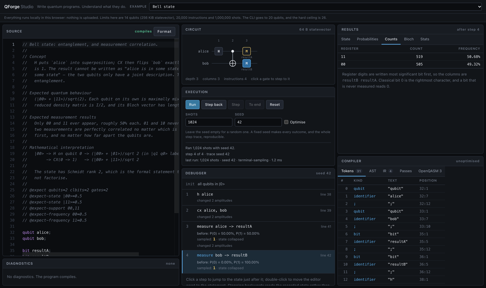
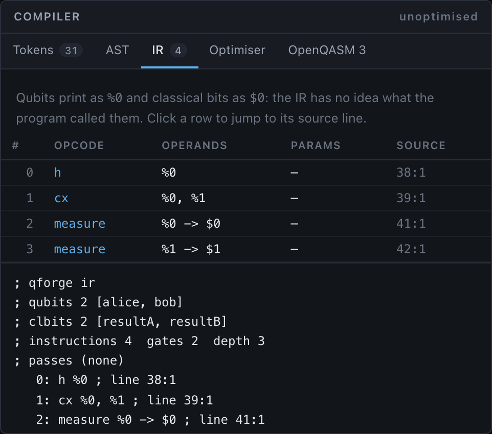
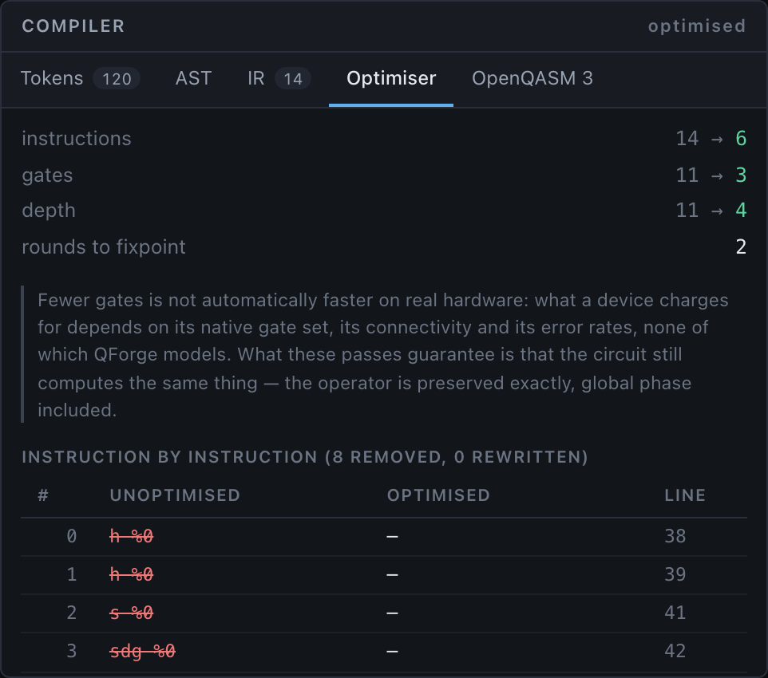
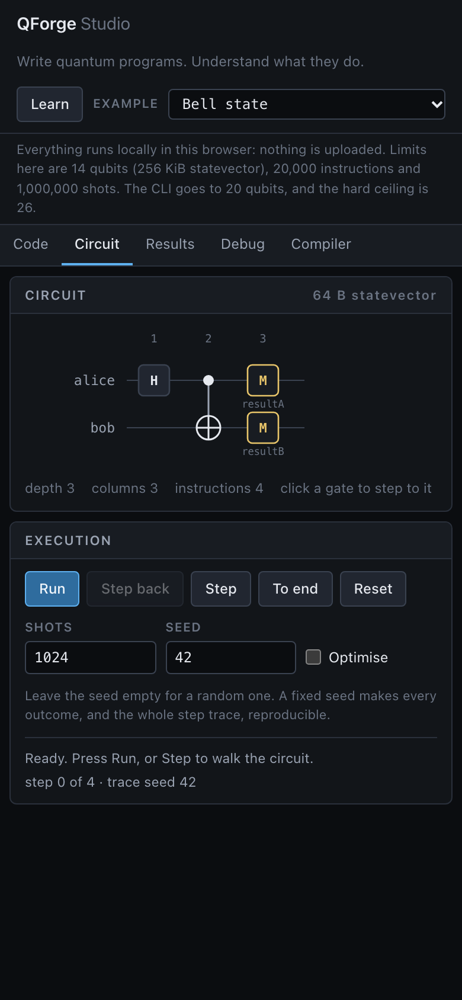

# QForge

[](https://github.com/itsshreyasbhardwaj-design/qforge/actions/workflows/ci.yml)
[](LICENSE)

**Write quantum programs. Understand what they do.**

A small programming language, a real compiler, an independent quantum simulator,
and a step debugger that shows you the quantum state one gate at a time.

```qforge
qubit alice;
qubit bob;

bit resultA;
bit resultB;

h alice;
cx alice, bob;

measure alice -> resultA;
measure bob -> resultB;
```

```console
$ qforge run examples/bell.qf --shots 1024 --seed 42
qubits 2  classical bits 2
gates 2  instructions 4  depth 3

shots 1024  seed 42  strategy terminal-sampling

state     count      freq
-----  --------  --------
11          519    0.5068
00          505    0.4932
```

Only `00` and `11`. Never `01`, never `10`. That is entanglement, and QForge
will walk you through exactly how it happens.



_The studio after stepping to the end of `examples/bell.qf` and running 1024
shots with seed 42. Left: the source with inline diagnostics. Middle: the
circuit, the run controls, and the step debugger showing each measurement's
exact probabilities alongside the outcome that was sampled — note that once
`alice` has been measured as 1, `bob` reads P(1) = 100%. Right: the counts, and
the compiler's own token stream. Every screenshot in this README is generated
from the production build by `pnpm screenshots`._

---

## What this is

A compiler engineering project first, a web application second.

| Stage     | What it is                                                  | Where                            |
| --------- | ----------------------------------------------------------- | -------------------------------- |
| Lexer     | Hand-written, single pass, total                            | `packages/language/src/lexer`    |
| Parser    | Recursive descent + Pratt expressions, multi-error recovery | `packages/language/src/parser`   |
| Semantics | Symbol table, name resolution, constant folding             | `packages/language/src/semantic` |
| IR        | Flat, syntax-independent, source-mapped                     | `packages/compiler/src/ir`       |
| Passes    | Four verified rewrites, run to a fixpoint                   | `packages/compiler/src/passes`   |
| Backend   | OpenQASM 3 for the supported subset                         | `packages/compiler/src/backends` |
| Simulator | Statevector, measurement, seeded sampling, traces           | `packages/simulator`             |
| CLI       | `check`, `run`, `compile`, `inspect`, `format`              | `packages/cli`                   |
| Studio    | Browser IDE with a step debugger                            | `apps/studio`                    |

Nothing here wraps an existing quantum SDK. The complex arithmetic, gate
kernels, measurement and collapse are all implemented in this repository.

## Why it exists

Two things are usually hidden. Compilers are black boxes — source goes in, a
binary comes out, and the interesting middle is invisible. Quantum computing is
presented either as dense linear algebra or as animated marketing, with little
in between.

QForge makes both visible at once. The same program appears as tokens, as a
syntax tree, as intermediate representation before and after optimisation, as
OpenQASM, and as a quantum state you can step through gate by gate.

## What is original about it

- **An optimisation contract stricter than correctness requires.** Passes
  preserve the circuit's _operator_ including global phase, not merely its
  measurement statistics. `rx(2*pi)` equals `-I`, so QForge does **not** remove
  it even though every probability would be unchanged; only multiples of `4*pi`
  are removed. That is what lets the debugger show identical amplitudes with
  optimisation on or off.
- **A single-scan adjacency test** that decides pass legality in one
  left-to-right walk, with barriers, measurements and resets blocking for free.
- **Automatic sampling-strategy selection.** Terminal measurements are sampled
  exactly from one final statevector; a reset or a gate after a measurement
  forces per-shot replay. The choice is reported, not hidden.
- **Recorded execution traces**, so stepping _backwards_ through a circuit with
  a measurement shows the branch that actually happened rather than re-rolling.
- **Three independent correctness references**, because testing a simulator
  against itself proves nothing.

## Quick start

Requires Node >= 20.9 and pnpm.

```bash
git clone https://github.com/itsshreyasbhardwaj-design/qforge.git qforge && cd qforge
pnpm install
pnpm build
pnpm test
```

Then use the CLI:

```bash
node packages/cli/dist/bin.js run examples/bell.qf --shots 1024 --seed 42
node packages/cli/dist/bin.js inspect examples/bell.qf --ir
node packages/cli/dist/bin.js compile examples/bell.qf
```

Or link it so `qforge` is on your PATH:

```bash
pnpm --filter qforge exec npm link
qforge --help
```

Or open the studio:

```bash
pnpm dev     # http://localhost:3147
```

## How the compiler works

```
source text
   -> tokenize()    Token[]        every character lands in exactly one token
   -> parse()       Program        typed AST, a span on every node
   -> analyze()     SemanticModel  names resolved to global indices, angles folded
   -> lower()       IrModule       flat, syntax-free, source-mapped
   -> optimize()    IrModule       four passes, run to a fixpoint
   -> emit / run    OpenQASM 3 | statevector simulation | execution trace
```

See it on your own program:

```bash
qforge inspect yours.qf --all
```

Diagnostics are data, never exceptions, so every error in a file is reported at
once:

```text
error QF202:
Unknown qubit 'target'

broken.qf:4:13

cx control, target;
            ^^^^^^

Declare it first, for example 'qubit target;'.
```



_The IR view: qubits as `%0` and `%1`, classical bits as `$0`, and a source
position on every instruction. Clicking a row moves the editor caret to the
statement that produced it._

Full detail: [compiler-design.md](docs/compiler-design.md).

## How the simulator works

An `n`-qubit state is `2^n` complex amplitudes, stored as two `Float64Array`s so
gate kernels allocate nothing.

- **Qubit 0 is the least significant bit** of the amplitude index, and ket
  labels print most significant first — the Qiskit and OpenQASM convention.
- A single-qubit gate pairs each amplitude index with its partner differing in
  one bit; `cx`, `ccx` and `swap` are permutations with no arithmetic at all.
- Measurement keeps the exact probabilities, the sampled outcome, and the
  collapsed state strictly separate, because conflating them is the usual way a
  simulator becomes misleading.
- `reset` is a measurement whose result is discarded plus a conditional flip,
  not a projection — which matters when the qubit is entangled.
- Randomness is xoshiro128\*\* seeded through splitmix32, so a run with a fixed
  seed is reproducible on any machine.

Full detail: [simulator-design.md](docs/simulator-design.md) and
[quantum-math.md](docs/quantum-math.md).

## How is this different from OpenQASM and Qiskit?

**It isn't a replacement for either.** Qiskit is a production framework with
hardware backends, transpilation for real topologies, noise models and a vast
algorithm library. OpenQASM is a specification. QForge is neither.

What QForge adds is pedagogical:

|                    | QForge                                               | OpenQASM 3                                            | Qiskit                             |
| ------------------ | ---------------------------------------------------- | ----------------------------------------------------- | ---------------------------------- |
| Purpose            | Learning compilers and quantum circuits              | An interchange specification                          | Building and running real circuits |
| Language           | ~15 productions, readable in one sitting             | A full language with classical types and control flow | Python API                         |
| Compiler internals | Every stage inspectable from the CLI and the UI      | n/a                                                   | Internal                           |
| Pass justification | Each pass states why its rewrite is valid, in the UI | n/a                                                   | Documented separately              |
| Step debugger      | Gate-by-gate state, exact backward stepping          | n/a                                                   | No equivalent                      |
| Hardware           | None                                                 | Vendor-dependent                                      | Yes                                |
| Noise              | None                                                 | n/a                                                   | Yes                                |

QForge **exports** OpenQASM 3 for the subset it can express, so a circuit
developed here can be taken elsewhere.



_The pass report for `examples/optimisable.qf`: fourteen instructions reduced to
six across two rounds, with every removal named, and each pass stating the
mathematical reason its rewrite is valid._

## Correctness

Testing a simulator against itself proves nothing, so the suite contains three
deliberately independent references.

| Reference                                                    | Why it is independent                                                                                               | Result                                                         |
| ------------------------------------------------------------ | ------------------------------------------------------------------------------------------------------------------- | -------------------------------------------------------------- |
| Dense-matrix oracle (`packages/simulator/src/reference`)     | Enumerates basis states and builds full `2^n x 2^n` operators; the production kernels manipulate bit masks in place | 150 random circuits up to 6 qubits agree to better than 1e-12  |
| Minimal OpenQASM reader (`tests/conformance/qasm-parser.ts`) | Regular expressions and shunting-yard; the QForge frontend is a hand-written lexer and a Pratt parser               | 140 emit-reparse-simulate round trips preserve the statevector |
| NumPy (`scripts/numpy-reference.mjs`)                        | Outside the language entirely, matrices written from textbook definitions                                           | 22 circuits agree to at most 5.6e-17, most bit-for-bit         |

Plus: unitarity assertions on every gate; analytic checks on X, H, Bell, GHZ,
H-Z-H and the rotation identities; asymmetric circuits that pin the bit order
(a Bell state cannot); property tests comparing _full statevectors_ before and
after optimisation; sampled frequencies against exact distributions at 5 sigma;
and 34 browser tests driving the real engine on desktop and mobile.

The Qiskit run found a real conformance bug: QForge emitted `if (c == 1)` for a
single-bit predicate, but OpenQASM 3 types a `bit` as a bit rather than an
integer, so the comparison must be against a boolean. The in-repo OpenQASM
reader had been written against QForge's own output and accepted it happily —
only an implementation with no knowledge of QForge caught it. Details in
[validation-report.md](docs/validation-report.md).

**The documentation is machine-checked too.** Every `examples/*.qf` carries
`@expect` directives describing its qubit count, probabilities and outcomes, and
CI executes each example and verifies them. Two genuine physics errors in the
example prose were caught this way during development — they are recorded in
[the journal](docs/development-journal.md).

## Performance

Measured on an Apple M2, Node 24. Full tables in
[benchmarks.md](docs/benchmarks.md); reproduce with `pnpm bench`.

|                                 |                                               |
| ------------------------------- | --------------------------------------------- |
| Compile 10,000 gates end to end | ~24 ms (~340k ops/second)                     |
| Hadamard throughput, 12+ qubits | ~400 million amplitudes/second (memory bound) |
| 1,000,000 shots, 12 qubits      | ~0.31 s (~3.2 million shots/second)           |
| 20 qubits, 390 gates            | ~0.9 s, 16 MiB statevector                    |

## Limitations

Stated plainly, in full in [limitations.md](docs/limitations.md):

- Classical control is **single-branch only**: no `else`, no loops, no nested
  conditionals, and conditions compare a bit against a constant rather than
  being general boolean expressions.
- No user-defined gates, subroutines or classical arithmetic.
- Statevector only: no density matrices, noise, or stabiliser backend.
- The OpenQASM backend covers only the subset QForge can express, and makes no
  conformance claim.
- Limits: 14 qubits in the browser, 20 in the CLI, 26 hard (1 GiB of
  amplitudes).
- No npm release, no language server, no OpenQASM importer.

## Examples

Each is executed by CI and checked against its own documentation.

| File                        | Concept                                                       |
| --------------------------- | ------------------------------------------------------------- |
| `declare.qf`                | Declarations and the empty circuit                            |
| `pauli-x.qf`                | A deterministic bit flip                                      |
| `superposition.qf`          | Hadamard; amplitude versus probability                        |
| `interference.qf`           | H-Z-H: why amplitudes are fundamental                         |
| `rotations.qf`              | Continuous rotations and angle expressions                    |
| `bell.qf`                   | Entanglement and correlated measurement                       |
| `ghz.qf`                    | Three-qubit entanglement                                      |
| `phase-kickback.qf`         | The mechanism behind most quantum algorithms                  |
| `deutsch-jozsa.qf`          | A provable one-query advantage                                |
| `deutsch-jozsa-constant.qf` | The same circuit, constant oracle                             |
| `mid-circuit-measure.qf`    | Collapse, and what `reset` really does                        |
| `optimisable.qf`            | A circuit the optimiser shrinks, and what it refuses to touch |

## The studio on a phone



Below 1100px the three-column workspace becomes a tabbed single column. The
circuit diagram, the debugger and the compiler inspector all work at phone
width; a Playwright project runs the full suite against a Pixel 7 profile.

## Running the tests

```bash
pnpm test              # unit, property, conformance, integration
pnpm coverage          # with coverage
pnpm build && pnpm test:e2e   # browser tests (desktop + mobile)
pnpm verify:numpy      # cross-check against NumPy, if installed
pnpm --filter @qforge/validation setup && \
  pnpm --filter @qforge/validation validate   # cross-check against Qiskit
pnpm bench             # performance measurements
pnpm lint              # ESLint
pnpm typecheck         # project-wide TypeScript
```

## Documentation

| Document                                                        | Covers                                                                    |
| --------------------------------------------------------------- | ------------------------------------------------------------------------- |
| [learning-guide.md](docs/learning-guide.md)                     | **Start here.** A guided path through the physics and the compiler        |
| [language-spec.md](docs/language-spec.md)                       | Full grammar, types, every diagnostic code                                |
| [architecture.md](docs/architecture.md)                         | Packages, data structures, the pipeline                                   |
| [compiler-design.md](docs/compiler-design.md)                   | Parsing strategy, IR, passes, backend                                     |
| [simulator-design.md](docs/simulator-design.md)                 | Kernels, sampling, tracing, RNG                                           |
| [quantum-math.md](docs/quantum-math.md)                         | Conventions, matrices, measurement, accuracy                              |
| [design-decisions.md](docs/design-decisions.md)                 | Every significant choice and its alternatives                             |
| [development-journal.md](docs/development-journal.md)           | What actually went wrong, and how it was found                            |
| [classical-control-design.md](docs/classical-control-design.md) | `if`, predication, and why the optimiser cannot move across a measurement |
| [independent-audit.md](docs/independent-audit.md)               | The audit that preceded 0.2, and the five defects it found                |
| [validation-report.md](docs/validation-report.md)               | Cross-validation against Qiskit                                           |
| [limitations.md](docs/limitations.md)                           | What QForge does not do                                                   |
| [benchmarks.md](docs/benchmarks.md)                             | Measured performance                                                      |
| [cli.md](docs/cli.md)                                           | Command reference                                                         |
| [technical-brief.md](docs/technical-brief.md)                   | One-page summary                                                          |

## Project status

Version 0.1, first public release. Built with AI assistance; the architecture,
conventions and correctness arguments are documented in full so they can be
reviewed rather than taken on trust. See
[author-learning-guide.md](docs/author-learning-guide.md).

Not published to npm. Package names are unverified.

## Contributing

See [CONTRIBUTING.md](CONTRIBUTING.md). The one rule worth stating up front: a
change to the simulator or the optimiser needs a test that would fail without
it, and "the existing tests still pass" is not evidence when the existing tests
share code with the change.

## Licence

MIT. See [LICENSE](LICENSE).
